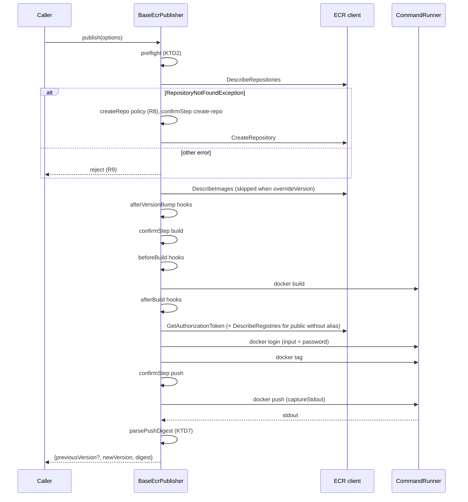
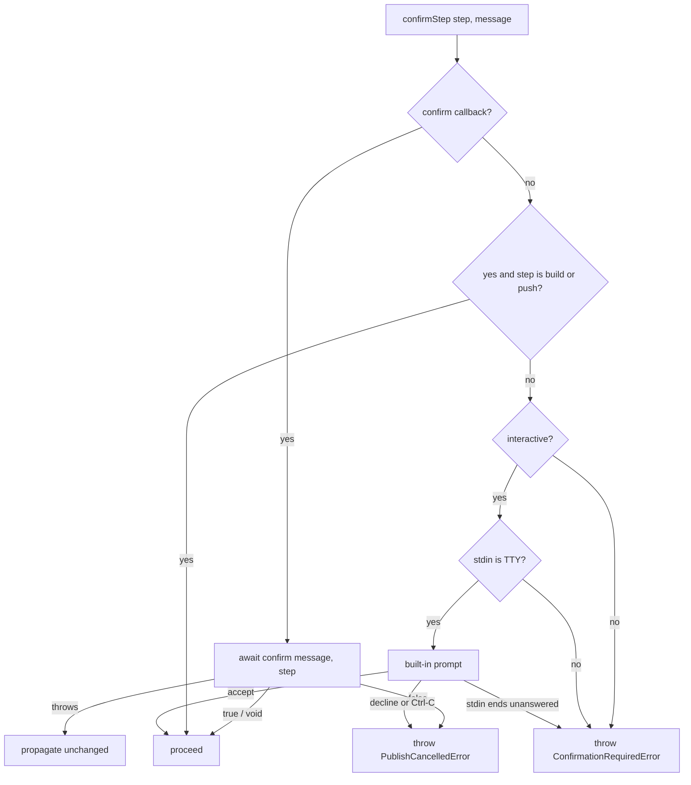

# ECR Publisher Headless Publish - Plan

## Goal Capsule

- **Objective:** CI release jobs in mapp-monorepo publish ECR images without a terminal through `@98kb/ecr-publisher`, get back the digest of the image they pushed, and mapp's vendored publisher copy is deleted.
- **Means:** `@98kb/ecr-publisher` 3.0.0 adds caller-controlled confirmations, interactivity, repo-creation policy, and command execution, and returns the pushed digest from `publish()` (Key Decisions; KTD1, KTD6, KTD7).
- **Product authority:** this Product Contract. Changes to the mapp-monorepo release CLI beyond the migration note are not active scope.
- **Implementation authority:** Planning Contract KTDs, then Implementation Units. An R wins over a KTD on product behavior; a KTD wins over a unit on mechanism.
- **Target repo:** `98kb/aws`; all work lands in `packages/ecr-publisher`.
- **Execution profile:** code; six units, U1 through U6 in dependency order. Library-only; no live AWS or Docker needed to finish.
- **Stop conditions:** stop and ask if a requirement cannot be met without changing the Behavior Matrix, if the 2.x interactive flow (R18) would visibly change beyond the documented line-based push output, or if `docker push` output on a real registry lacks the digest line.
- **Finish and ship:** the implementer lands U1–U6 and the Verification Contract passes. Publishing 3.0.0 to npm and the mapp migration are done by the maintainer after the manual smoke check.
- **Open blockers:** none.

---

## Product Contract

### Summary

Both publishers (`EcrPublisher`, `PublicEcrPublisher`) take an optional settings object that controls confirmations, interactivity, repo creation, and the command runner.
`publish()` resolves with `{previousVersion?, newVersion, digest}`, where `digest` comes from this run's `docker push` output.
The library never exits the process, and the CLI gains `--yes`, `--non-interactive`, and `--create-repo`.

### Problem Frame

The mapp-monorepo release CLI (`@mapp/release-sdk`) gained a headless mode (`--yes`, `--non-interactive`, `RELEASE_YES`, `--result-file`) for CI.
`@98kb/ecr-publisher` blocks it in two places.
First, it calls `prompts` directly for three confirmations (create missing repo, build, push), and on decline calls `process.exit(0)` from inside the library (`packages/ecr-publisher/src/promptConfirmOrExit.ts`, `createEcrRepo.ts`, `createEcrPublicRepo.ts`).
Second, `publish()` returns only `{previousVersion, newVersion}`; the caller needs the pushed digest for `--result-file` and for digest checks at deploy time.

To unblock CI, mapp vendored about 230 lines of ecr-publisher 2.5.6 into `packages/release-sdk/src/EcrPublisher.ts` on branch `trunk/release-cli-headless-mode`.
That copy drops public ECR support and Docker error guidance, and will drift from the library.

Two latent defects make headless use riskier than interactive use today.
`checkEcrRepoExists` treats any error (access denied, throttling, network) as "repo missing", so an auto-approved create would fire on an auth failure.
`handleDockerError` throws inside a spawn `'error'` listener, so a missing Docker binary escapes as an uncaught exception and the `publish()` promise never settles.

### Key Decisions

- **Separate repo-creation policy; `yes` never creates repos.** Creating a repo is a durable resource change, and a missing repo in CI usually means a typo or a missed provisioning step. Governs R8, R9. (session-settled: user-directed — chosen over letting `yes` also answer repo creation, and over never allowing automatic creation: CI should not create repos unless the caller opted in explicitly)
- **Release as 3.0.0.** Throwing instead of exiting and making `previousVersion` optional are breaking changes; known consumers pin exact versions and need code changes anyway. Governs R20. (session-settled: user-directed — chosen over 2.7.0 treating the breaks as bug fixes, and over a fully back-compatible 2.7.0 that keeps `process.exit`: honest semver at low cost)
- **CLI gets thin flags, no machine-readable output.** Each flag maps one-to-one onto a library option; `--json` would add an output contract no current consumer needs. Governs R19. (session-settled: user-directed — chosen over library-only, and over adding `--json`/`--result-file`)
- **A confirm callback is the primary control; `yes` and `interactive` are shortcuts over it.** mapp can pass `session.confirm` unchanged because a `void` return means proceed. Governs R2, R3, R4, R5. (session-settled: user-approved — chosen over a flag-only API: a flag pair cannot carry the caller's own prompt or cancellation semantics)
- **The digest is always captured; there is no opt-out.** Push stdout is piped and echoed, so Docker's live progress bars become line output in every mode. Governs R12, R13. (session-settled: user-approved — chosen over opt-in capture or a post-push tag lookup: the digest must be guaranteed and must not race a concurrent run that moves the tag)
- **Headless runs without confirmation authority fail before any side effect.** Governs R6. (session-settled: user-approved — chosen over failing at the first confirmation mid-run: no half-built image or partial push is left behind)
- **`interactive` defaults to `true`; no TTY auto-detection.** Today's CLI and library users keep today's prompts unchanged; callers decide headlessness explicitly. Governs R4.

### Requirements

**Publisher settings and confirmations**

- R1. `EcrPublisher` and `PublicEcrPublisher` constructors accept an optional second argument, a settings object; the first argument (the ECR client) and the `createEcrPublisher` / `createPublicEcrPublisher` factories keep working without it.
- R2. Setting `confirm` takes a message and returns (or resolves to) `true` or `void` to proceed, or `false` to decline; anything it throws propagates out of `publish()` unchanged.
- R3. Setting `yes: true` auto-approves the build and push confirmations when no `confirm` callback is supplied.
- R4. Setting `interactive` (default `true`) controls headlessness: when `false`, the library never prompts, Docker child processes get no inherited stdin, and spinners print plain lines instead of redrawing.
- R5. A build or push confirmation is answered by the first available of: the `confirm` callback, `yes`, the built-in terminal prompt when `interactive` is `true`. If the built-in prompt would answer any confirmation (repo, build, or push) but stdin is not a TTY or closes before an answer, `publish()` rejects with the confirmation-required error rather than hanging or exiting.
- R6. When `interactive` is `false` and neither `confirm` nor `yes` is set, `publish()` rejects with a typed confirmation-required error before any AWS or Docker call.
- R7. Declining a confirmation — the `confirm` callback returning `false`, or declining or pressing Ctrl-C on the built-in prompt — rejects `publish()` with a typed cancellation error; an error thrown by `confirm` propagates unchanged per R2. The library never calls `process.exit`.

**Repository creation**

- R8. Setting `createRepo` (`'prompt' | 'always' | 'never'`, default `'prompt'`) decides what happens when the target repo is missing, per the behavior matrix below; `yes` never answers the repo-creation question.
- R9. Only a repository-not-found response counts as a missing repo, for both private and public ECR; any other error from the existence check propagates.

**Result and digest**

- R10. `publish()` resolves with `{previousVersion?: string; newVersion: string; digest: string}`; `previousVersion` is absent when `overrideVersion` was used.
- R11. Hooks keep their names, order, and contract: `afterVersionBump`, `beforeBuild`, `afterBuild` are chainable and each receives and returns the context.
- R12. `digest` is the last `digest: sha256:<64 hex>` match in this run's `docker push` stdout; with no match, `publish()` rejects with an error naming the pushed tag. The digest is never obtained by looking the tag up afterwards.
- R13. `docker push` stdout is echoed to the terminal as it arrives while being captured, in both interactive and headless modes.

**Command execution**

- R14. Setting `runner` replaces the function that runs every Docker command (build, login, tag, push); the runner type is exported, and the default runner uses `cross-spawn`.
- R15. The runner contract covers stdin input (for `--password-stdin` login), the interactive/headless stdio choice from R4, and stdout capture returning the captured text.
- R16. A spawn failure or non-zero exit rejects `publish()` with an error naming the command that failed. Before rejecting, a spawn error with code `ENOENT` prints the existing Docker-not-found guidance and `EACCES` prints the existing permission guidance (today's message-text matchers never see these spawn errors).
- R17. Windows behavior from 2.5.4 does not regress: commands spawn through `cross-spawn` with argument arrays, never shell strings, and the registry password goes through stdin.

**Defaults and CLI**

- R18. With no settings object, an interactive run reproduces today's flow: same steps and order, same prompt messages, same `version` / `built-at` labels, same version resolution (override, or latest semver tag plus bump plus `versionPrefix`).
- R19. The `ecr-publisher` CLI adds `--yes`, `--non-interactive`, and `--create-repo <prompt|always|never>`, mapped to R3, R4, and R8; the success line prints the digest; cancellation exits 0 and every other error exits 1.

**Release and verification**

- R20. The package ships as 3.0.0, and the README lists the breaking changes (throw instead of exit, optional `previousVersion`, line-based push output) and documents the settings and CLI flags.
- R21. Tests cover, without `prompts.inject` or a real Docker daemon: the headless `yes` path end to end with a fake runner and fake ECR client; a headless run without `yes` rejecting before any runner or ECR call; digest parsing with multiple matches (last wins) and with none (rejects); each `createRepo` mode in interactive and headless runs; and a non-not-found existence error propagating.

### Behavior Matrix

Build and push confirmations (R5, R6). "Callback" means a `confirm` setting is supplied.

| `interactive` | `confirm` | `yes` | Build / push confirmations |
|---|---|---|---|
| `true` | callback | any | callback answers |
| `true` | none | `true` | auto-approve |
| `true` | none | `false` | built-in terminal prompt (today) |
| `false` | callback | any | callback answers |
| `false` | none | `true` | auto-approve |
| `false` | none | `false` | reject before any side effect (R6) |

Missing repository (R8). `yes` has no effect on any row.

| `createRepo` | `interactive: true` | `interactive: false` |
|---|---|---|
| `'prompt'` (default) | ask via callback if supplied, else built-in prompt; decline rejects (R7) | reject with typed repo-missing error |
| `'always'` | create without asking | create without asking |
| `'never'` | reject with typed repo-missing error | reject with typed repo-missing error |

An existing repo continues in every row. Repo checks run before the build, so a repo-missing rejection leaves nothing built or pushed.

### Acceptance Examples

- AE1. **Covers R3, R10, R12, R13.** **Given** `interactive: false`, `yes: true`, an existing repo, and a runner whose push output contains two `digest: sha256:…` lines, **when** `publish()` runs, **then** it resolves with the second digest and the new version, and no prompt is shown.
- AE2. **Covers R6.** **Given** `interactive: false` with neither `confirm` nor `yes`, **when** `publish()` runs, **then** it rejects with the confirmation-required error, and neither the ECR client nor the runner was called.
- AE3. **Covers R8.** **Given** a missing repo, `interactive: false`, `yes: true`, and default `createRepo`, **when** `publish()` runs, **then** it rejects with the repo-missing error, and no repo is created.
- AE4. **Covers R8, R2.** **Given** a missing repo, `interactive: true`, default `createRepo`, and a `confirm` callback that auto-approves, **when** `publish()` runs, **then** the callback is asked about repo creation and the repo is created; a caller whose callback auto-approves owns that outcome.
- AE5. **Covers R9.** **Given** the existence check fails with access denied, **when** `publish()` runs under `createRepo: 'always'`, **then** that error propagates, and no create call is made.
- AE6. **Covers R12.** **Given** push output with no digest line, **when** `publish()` runs, **then** it rejects with an error naming the pushed tag, after the push completed.
- AE7. **Covers R7, R19.** **Given** the CLI run interactively, **when** the user declines the build prompt, **then** the process exits 0 with a cancellation message, as in 2.x.

### Scope Boundaries

- No `--json` or `--result-file` on the CLI; mapp writes its own result file from the returned `PublishResult`.
- No TTY auto-detection for `interactive` (see Key Decisions).
- Version-lookup and semver logic are not reworked; the library's current behavior is the reference, not the mapp copy's.
- Removing the unused `fp-ts` dependency is optional tidy-up, not required scope.
- mapp's `ReleaseSession`, flags, and result-file format are not changed by this work.

### Migration Note: mapp-monorepo

On branch `trunk/release-cli-headless-mode` of mapp-monorepo, after 3.0.0 is published:

1. Bump `@98kb/ecr-publisher` in `packages/release-sdk/package.json` from `2.5.6` to `^3.0.0`.
2. Replace `new EcrPublisher(session, ECR.getInstance().client)` in `packages/release-sdk/src/ImageBuilder.ts` with `new EcrPublisher(ECR.getInstance().client, {confirm: msg => session.confirm(msg), interactive: session.interactive})`, adding `createRepo: 'always'` only if mapp should create repos from CI.
3. Delete `packages/release-sdk/src/EcrPublisher.ts`, and point imports of `PublishEcrOptions`, `PublishResult`, and the hook types (`ImageBuilder.ts`, `ImageRebuilder.ts`, `index.ts`) at `@98kb/ecr-publisher`.
4. Pass `bump` explicitly where the copy relied on its optional `bump` defaulting to `patch`; the library schema requires it.
5. Tests that injected a runner through the third constructor argument pass `runner` in the settings object instead; delete `runCommand` from release-sdk if nothing else uses it.

### Dependencies / Assumptions

- `docker push` prints `digest: sha256:<64 hex>` for both private and public ECR registries when stdout is piped; the mapp copy relies on this for private ECR, and public ECR is assumed to match.
- mapp's `session.confirm(message)` resolves `void` to proceed and throws `CancelledError` on decline, which R2 accepts as-is.
- Known consumers are mapp-monorepo (pinned `2.5.6`) and possibly `iodatalabs/algot` `packages/release-sdk`; the latter's usage is unverified.

### Outstanding Questions

The three questions deferred to planning are resolved in the Planning Contract: typed error shape (KTD3), step passed to `confirm` (KTD4), and public-ECR not-found detection (KTD5).

### Sources / Research

- `packages/ecr-publisher/src/BaseEcrPublisher.ts` — current `publish()` flow, hooks, and `PublishResult` construction.
- `packages/ecr-publisher/src/PublishResult.ts` — today's return type, `{previousVersion: string; newVersion: string}`.
- `packages/ecr-publisher/src/uploadImageToECR.ts`, `buildDockerImage.ts` — build and push confirmations; push runs with inherited stdio.
- `packages/ecr-publisher/src/checkEcrRepoExists.ts` — swallows every error as "missing".
- `packages/ecr-publisher/src/executeCommand.ts`, `handleDockerError.ts` — throw inside the spawn `'error'` listener; generic "Docker build failed" message for every command.
- mapp-monorepo `trunk/release-cli-headless-mode:packages/release-sdk/src/EcrPublisher.ts` and `runCommand.ts` — reference behavior for confirm-through-session, tee'd push capture, and digest parsing.

---

## Planning Contract

Product Contract preservation: unchanged, except that the three deferred-to-planning questions under Outstanding Questions now point to the KTDs that resolve them.

### Key Technical Decisions

- KTD1. **One confirmation resolver owns the R5 answer order.** A single `confirmStep` function takes the context, a step (`create-repo` | `build` | `push`), and a message. It answers in R5 order, and on decline it throws the typed cancellation (R7). It replaces `packages/ecr-publisher/src/promptConfirmOrExit.ts` and the inline `prompts` calls in both `createEcr*Repo` files, so no other module imports `prompts`. Settings are normalized once in the constructor (defaults `interactive: true`, `yes: false`, `createRepo: 'prompt'`, default runner) and stored on `Context.settings`, so hooks and helpers read the resolved values. Governs R2–R5, R7, R8.
- KTD2. **`publish()` runs a preflight before any AWS or Docker call.** It rejects with the confirmation-required error in two cases. The first is R6. The second is `interactive: true` with no `confirm`, no `yes`, and `process.stdin.isTTY` falsy: the built-in prompt could never answer the build confirmation, so the run fails now instead of after repo checks (R5). The one case the preflight cannot see is a missing repo under `createRepo: 'prompt'` with `yes: true` and no TTY. There the repo prompt itself raises confirmation-required when it finds no TTY. Governs R5, R6.
- KTD3. **Typed errors share an exported `EcrPublisherError` base class with a stable `code`.** The subclasses are `ConfirmationRequiredError` (`CONFIRMATION_REQUIRED`), `PublishCancelledError` (`CANCELLED`), `RepositoryMissingError` (`REPO_MISSING`, carries `repo`), `DigestNotFoundError` (`DIGEST_NOT_FOUND`, carries `imageTag`), and `CommandFailedError` (`COMMAND_FAILED`, carries the command string and the exit code or spawn error code). The exported `isEcrPublisherError(error, code?)` checks `code`, not `instanceof`, so the check still works when a consumer ends up with two copies of the package. Errors from a caller's `confirm` are never wrapped (R2).
- KTD4. **`confirm` gets the step as an optional second argument.** It is called as `confirm(message, {step})`, where `step` is `create-repo`, `build`, or `push`. A one-argument callback such as mapp's `session.confirm` still type-checks and still works. The callback gets the plain message text. The built-in prompt keeps today's chalk-formatted text (R18). Governs R2.
- KTD5. **Not-found detection matches on the error name.** Both existence checks treat an error as "missing" only when `error.name === 'RepositoryNotFoundException'`, and rethrow every other error (R9). Both SDKs export a `RepositoryNotFoundException` class (`@aws-sdk/client-ecr` models, `@aws-sdk/client-ecr-public` `models/errors`). The name match is used instead of `instanceof` because the clients come from the caller, and the SDKs are both dependencies and peer dependencies here, so duplicate copies are likely. A shared `isRepositoryNotFound` helper serves both checks.
- KTD6. **One `CommandRunner` contract replaces `executeCommand` and `executeCommandWithStdin`.** Directional shape: the runner takes `{command, args, input?, interactive, captureStdout?}` and resolves `{stdout}`. Default runner (R14, R15, R17):
  1. Spawns through `cross-spawn` with an argument array.
  2. stdin is `pipe` when `input` is set, else `inherit` when interactive, else `ignore`.
  3. stdout is `pipe` when capturing (each chunk is written to `process.stdout` and also appended to the buffer), else `inherit`. stderr is always `inherit`.
  4. Settles exactly once, even when both `error` and `close` fire.
  5. On a spawn error, prints Docker guidance by code (`ENOENT` → not-found help, `EACCES` → permission help) and rejects with `CommandFailedError`. A non-zero exit also rejects with `CommandFailedError`.
  6. The error message names `command` and `args` and never includes `input`, which holds the registry password.

  Only `docker push` sets `captureStdout`. The runner never throws inside an event listener, which fixes the uncaught exception from Problem Frame.
- KTD7. **Digest parsing is a pure function.** `parsePushDigest(stdout)` returns the last `digest: (sha256:[0-9a-f]{64})` match, or `undefined`. The upload step throws `DigestNotFoundError` with the pushed tag when it gets `undefined` (R12). The digest is never read from ECR.
- KTD8. **Spinners go through one helper.** `startSpinner(text, interactive)` passes `isEnabled: false` to `ora` only when `interactive` is false, and leaves `isEnabled` unset otherwise. ora's documented behavior is that `isEnabled: false` still prints the text but drops spinner animation and ANSI codes, which gives plain lines in headless mode (R4). Leaving it unset in interactive runs keeps ora's own TTY/CI detection. Forcing `isEnabled: true` would make a `--yes` CI run without `--non-interactive` write animation frames and cursor codes into logs, which R18 rules out. Every spinner, including the existence-check spinner in `ensureECRRepo.ts`, goes through this helper.
- KTD9. **CLI logic moves into a testable `cli.ts`.** It holds the commander program definition, `toPublisherSettings(opts)`, and `exitCodeFor(error)` (cancellation → 0, everything else → 1). `bin.ts` only calls it. Commander's `Option.choices` validates `--create-repo`. Settings flags are kept out of the `PublishEcrOptions` passed to `publish()`. Governs R19.

### High-Level Technical Design

Publish sequence. It keeps the 2.x step order (R18) and adds the preflight and digest capture.

Confirmation resolution for one step (KTD1). The `create-repo` step runs only under `createRepo: 'prompt'` with `interactive: true`. The other Behavior Matrix rows return before reaching it.

### Assumptions

- `prompts` reports Ctrl-C through `onCancel`. A closed stdin can leave it waiting with no answer. The built-in prompt wrapper (U1) therefore races the prompt against stdin `end`/`close` and maps that to confirmation-required. Exactly how `prompts` behaves is checked during implementation with a mocked `prompts` module.
- ora picks its output stream itself (stderr). Changing that stream is out of scope; only animation is turned off in headless mode.

### Sequencing

U1 → U2 → U3 → U4 → U5 → U6. U2 and U3 each depend only on U1, so they can land in either order. Each unit only adds or rewrites modules and keeps the old helpers in place until their last caller moves. U4 rewires `buildDockerImage.ts` and `uploadImageToECR.ts`, and that is where `promptConfirmOrExit.ts`, `executeCommand.ts`, and `executeCommandWithStdin.ts` are deleted. This way every unit lands as a commit that passes typecheck.

---

## Implementation Units

### U1. Settings, typed errors, and confirmation resolver

- **Goal:** Add the settings types, the error hierarchy, the spinner helper, and the single confirmation path that replaces exiting on decline.
- **Requirements:** R2, R3, R4, R5, R7; KTD1, KTD3, KTD4, KTD8.
- **Dependencies:** none.
- **Files:**
  - create `packages/ecr-publisher/src/errors.ts`
  - create `packages/ecr-publisher/src/PublisherSettings.ts` (public `PublisherSettings`, `ConfirmFn`, `ConfirmStep`, `CreateRepoPolicy`, and the internal resolved form plus its normalizer)
  - create `packages/ecr-publisher/src/confirmStep.ts`
  - create `packages/ecr-publisher/src/startSpinner.ts`
  - modify `packages/ecr-publisher/src/Context.ts` (add `settings`)
  - test `packages/ecr-publisher/src/__tests__/confirmStep.test.ts`, `packages/ecr-publisher/src/__tests__/errors.test.ts`
- **Approach:**
  1. Write the error classes per KTD3. Each one sets `name` to its class name, so messages print cleanly in the CLI.
  2. The normalizer fills defaults and leaves `runner` unset until U2 provides the default runner.
  3. `confirmStep` follows the KTD1 flowchart. The built-in prompt uses `prompts` with `onCancel`, and its TTY check reads `process.stdin.isTTY`.
  4. The built-in prompt races the `prompts` call against stdin `end`/`close`. If stdin ends first, it throws `ConfirmationRequiredError` and ignores any later answer (R5).
- **Patterns to follow:** the one-function-per-file layout and named exports used across `packages/ecr-publisher/src/`. Respect the repo's eslint limits (`max-statements`, `complexity`) by splitting helpers rather than disabling rules.
- **Test scenarios:**
  - A callback returning `true` and a callback returning `undefined` both proceed. The callback receives the message and `{step}`.
  - A callback returning `false` throws `PublishCancelledError` with code `CANCELLED`.
  - A callback that throws a custom error propagates that same error instance.
  - With no callback and `yes: true`, `build` and `push` proceed without calling `prompts`.
  - With no callback and `yes: true`, `create-repo` is not auto-approved. It falls through to the interactive/TTY branch.
  - `interactive: false` with no callback and no `yes` throws `ConfirmationRequiredError`.
  - `interactive: true`, no TTY (stub `process.stdin.isTTY` falsy): throws `ConfirmationRequiredError`, and `prompts` is never called.
  - `interactive: true` with a TTY and mocked `prompts` answering `true` proceeds.
  - Mocked `prompts` answering `false` throws `PublishCancelledError`, and so does mocked `prompts` invoking `onCancel`.
  - TTY present, mocked `prompts` left pending, stdin emits `end`: throws `ConfirmationRequiredError` and does not hang.
  - `isEcrPublisherError` matches by code on a plain object carrying `code` and `name`. It returns false for an unrelated `Error`.
- **Verification:** `confirmStep` never calls `process.exit`. The new modules typecheck alongside the untouched 2.x callers.

### U2. Command runner with stdout capture and spawn-error handling

- **Goal:** Replace both spawn helpers with the injectable `CommandRunner` and its `cross-spawn` default.
- **Requirements:** R14, R15, R16, R17; KTD6.
- **Dependencies:** U1 (`CommandFailedError`, settings normalizer default).
- **Files:**
  - create `packages/ecr-publisher/src/CommandRunner.ts` (exported type)
  - create `packages/ecr-publisher/src/defaultRunner.ts`
  - modify `packages/ecr-publisher/src/handleDockerError.ts` (becomes code-based guidance printing, returns nothing, never throws)
  - modify `packages/ecr-publisher/src/PublisherSettings.ts` (default `runner`)
  - test `packages/ecr-publisher/src/__tests__/defaultRunner.test.ts`
- **Approach:**
  1. Map stdio per KTD6.
  2. Use a settle-once guard shared by the `error` and `close` handlers.
  3. Keep the existing help text in `handleDockerError.ts` verbatim, but select it by `error.code` (`ENOENT`, `EACCES`) instead of message substrings.
- **Patterns to follow:** current `cross-spawn` usage in `packages/ecr-publisher/src/executeCommand.ts` (from 2.5.4, commit `f0af584`).
- **Test scenarios:** (spawn `process.execPath` with `-e` scripts; no Docker)
  - A command that prints `a\nb` with `captureStdout` resolves `stdout` containing both lines. A spy on `process.stdout.write` saw the same bytes.
  - With `input: "secret"`, a child script that echoes its stdin back produces `secret`.
  - With `interactive: false` and no `input`, a child that reads stdin sees EOF immediately rather than blocking.
  - A child exiting with code 3 rejects with `CommandFailedError`. The message names the command, and `exitCode` is 3.
  - A non-existent binary rejects with `CommandFailedError` whose spawn code is `ENOENT`, after the Docker-not-found help was printed (spy `console.error`). The promise settles.
  - A failure for a run with `input` set does not include the input value in the error message.
- **Verification:** the default runner never leaves a pending promise on spawn failure.

### U3. Repository existence check and creation policy

- **Goal:** Treat only repository-not-found as missing, and apply the `createRepo` policy from the Behavior Matrix.
- **Requirements:** R8, R9; KTD5; AE3, AE4, AE5.
- **Dependencies:** U1.
- **Files:**
  - create `packages/ecr-publisher/src/isRepositoryNotFound.ts`
  - modify `packages/ecr-publisher/src/checkEcrRepoExists.ts`, `packages/ecr-publisher/src/checkEcrPublicRepoExists.ts`, `packages/ecr-publisher/src/ensureECRRepo.ts`, `packages/ecr-publisher/src/createEcrRepo.ts`, `packages/ecr-publisher/src/createEcrPublicRepo.ts`
  - test: create `packages/ecr-publisher/src/__tests__/checkEcrRepoExists.test.ts`; update `packages/ecr-publisher/src/__tests__/checkEcrPublicRepoExists.test.ts` and `packages/ecr-publisher/src/__tests__/ensureECRRepo.test.ts`
- **Approach:**
  1. `ensureECRRepo` takes the context (with settings). On a missing repo it decides by the Behavior Matrix:
     - `'always'` creates.
     - `'never'`, or `'prompt'` with `interactive: false`, throws `RepositoryMissingError`.
     - `'prompt'` with `interactive: true` calls `confirmStep` with step `create-repo`, using today's prompt text.
  2. The `createEcr*Repo` functions only create the repo (behind a spinner via `startSpinner`); they no longer prompt.
  3. Stop the existence-check spinner in a `finally`, so a propagated error does not leave it spinning.
- **Patterns to follow:** existing private/public split in `packages/ecr-publisher/src/ensureECRRepo.ts`. Keep the client-required guard errors as they are.
- **Test scenarios:**
  - Each check returns `true` on success.
  - Each check returns `false` for an error named `RepositoryNotFoundException`.
  - Each check rethrows an `AccessDeniedException`-named error. This replaces the existing "returns false for any error" test.
  - Covers AE5. Existence check throws access denied under `createRepo: 'always'`: `ensureECRRepo` rejects with that error, and the create function is not called.
  - Covers AE3. Missing repo, `interactive: false`, `yes: true`, default policy: rejects with `RepositoryMissingError` carrying the repo name, and create is not called.
  - Missing repo with `'never'` rejects with `RepositoryMissingError` in both interactive and headless runs.
  - Missing repo with `'always'` creates without calling `confirm` or `prompts`, in both interactive and headless runs.
  - Covers AE4. Missing repo, `interactive: true`, default policy, an auto-approving `confirm`: `confirm` is called with step `create-repo`, then create is called.
  - Missing repo, `interactive: true`, default policy, `confirm` returning `false`: rejects with `PublishCancelledError`, and create is not called.
  - Missing repo, `interactive: false`, default policy, `confirm` supplied: rejects with `RepositoryMissingError`, and `confirm` is not called (headless column of the matrix).
  - An existing repo continues for every policy.
  - Public-ECR variants of the missing and not-missing paths hit only the public client.
- **Verification:** both existence checks and every `createRepo` row are covered for private and public ECR.

### U4. Publisher wiring, digest result, and exports

- **Goal:** Thread settings and the runner through the publish flow, add the preflight, return `{previousVersion?, newVersion, digest}`, and export the new public surface.
- **Requirements:** R1, R6, R10, R11, R12, R13, R18; KTD2, KTD7; AE1, AE2, AE6.
- **Dependencies:** U1, U2, U3.
- **Files:**
  - create `packages/ecr-publisher/src/parsePushDigest.ts`
  - delete `packages/ecr-publisher/src/promptConfirmOrExit.ts`, `packages/ecr-publisher/src/executeCommand.ts`, `packages/ecr-publisher/src/executeCommandWithStdin.ts` (their last callers move here)
  - modify:
    - `packages/ecr-publisher/src/BaseEcrPublisher.ts`, `packages/ecr-publisher/src/EcrPublisher.ts`, `packages/ecr-publisher/src/PublicEcrPublisher.ts`
    - `packages/ecr-publisher/src/createEcrPublisher.ts`, `packages/ecr-publisher/src/createPublicEcrPublisher.ts`
    - `packages/ecr-publisher/src/buildDockerImage.ts`, `packages/ecr-publisher/src/uploadImageToECR.ts`
    - `packages/ecr-publisher/src/PublishResult.ts`, `packages/ecr-publisher/src/index.ts`
  - test:
    - create `packages/ecr-publisher/src/__tests__/parsePushDigest.test.ts`, `packages/ecr-publisher/src/__tests__/publish.test.ts`
    - update `packages/ecr-publisher/src/__tests__/uploadImageToECR.test.ts`, `packages/ecr-publisher/src/__tests__/EcrPublisher.test.ts`, `packages/ecr-publisher/src/__tests__/PublicEcrPublisher.test.ts`
- **Approach:**
  1. Constructors take `(client, settings?)` and normalize settings onto the context (KTD1). The factories forward an optional `settings`.
  2. `publish()` runs the preflight (KTD2) before `ensureECRRepo`.
  3. `buildDockerImage` and the push step call `confirmStep` where `promptConfirmOrExit` was. They run Docker through `context.settings.runner` with `interactive` from settings. Login passes the password as `input`.
  4. `uploadImageToECR` returns `{imageTag, digest}` from the captured push stdout (KTD7).
  5. `toPublishResult` leaves out `previousVersion` when `overrideVersion` was used.
  6. `index.ts` additionally exports the errors, `isEcrPublisherError`, settings types, `CommandRunner`, `Hook`, and `Context`. `Hook` and `Context` are needed by the mapp migration (step 3).
  7. Keep every existing log line, label, and step order (R18).
- **Patterns to follow:** the hook application in `BaseEcrPublisher.applyHooks`, and `packages/ecr-publisher/src/__tests__/uploadImageToECR.test.ts` fake clients that dispatch on command class.
- **Test scenarios:**
  - `parsePushDigest`:
    - one match returns it
    - two matches return the second
    - uppercase hex or a 63-character hash does not match
    - empty output returns `undefined`
  - Covers AE1. `publish.test.ts`: `interactive: false`, `yes: true`, existing repo, fake ECR client (describe repos ok, describe images with `1.2.0`, auth token), fake runner whose push output contains two digest lines. Resolves `{previousVersion: "1.2.0", newVersion: "1.3.0", digest: <second>}`. The runner saw build, login, tag, and push in order, all with `interactive: false`. Login carried `input` and push carried `captureStdout`. `prompts` (mocked to throw) was never called.
  - Covers AE2. `interactive: false` with neither `confirm` nor `yes`: rejects with `ConfirmationRequiredError`. Zero `send` calls on the fake client and zero runner calls.
  - `interactive: true`, no `confirm`, no `yes`, stdin not a TTY: rejects with `ConfirmationRequiredError` before any client or runner call.
  - Covers AE6. Push output without a digest line: rejects with `DigestNotFoundError` naming the full pushed tag. The runner's push call already happened.
  - `overrideVersion` set: the result has no `previousVersion` key, and `DescribeImages` was not sent.
  - Hooks: `afterVersionBump`, `beforeBuild`, and `afterBuild` run in that order, each receiving the context returned by the previous hook. `beforeBuild` runs after the build confirmation.
  - A `confirm` returning `false` at the push step rejects with `PublishCancelledError` after build, login, and tag ran, and before push ran.
  - The runner rejecting on build propagates its `CommandFailedError`, and no ECR auth call follows.
  - `PublicEcrPublisher` headless run with `yes`: login targets `public.ecr.aws`, and the digest comes from push output.
  - Constructors with one argument still work. `createEcrPublisher(ecr)` behaves as 2.x defaults (settings `interactive: true`, `createRepo: 'prompt'`).
- **Verification:** the full test suite passes with no real Docker or AWS. `tsc --noEmit` passes, and the `PublishResult` type matches R10. In `packages/ecr-publisher/src`, `prompts` is imported only by `confirmStep.ts`, `cross-spawn` only by `defaultRunner.ts`, and no library module calls `process.exit`.

### U5. CLI flags and exit codes

- **Goal:** Add `--yes`, `--non-interactive`, and `--create-repo <prompt|always|never>`, print the digest on success, and map cancellation to exit 0.
- **Requirements:** R19; KTD9; AE7.
- **Dependencies:** U4.
- **Files:**
  - create `packages/ecr-publisher/src/cli.ts`
  - modify `packages/ecr-publisher/src/bin.ts`
  - test `packages/ecr-publisher/src/__tests__/cli.test.ts`
- **Approach:**
  1. Move the commander definition into `cli.ts` behind a function that builds the program. Commander's parse is not triggered on import.
  2. `bin.ts` builds the program and parses `process.argv`.
  3. The action passes the publish options parsed by `publishEcrOptionsSchema` to `publish()`, and builds settings separately with `toPublisherSettings`.
  4. On success, print a final line with the pushed version and digest.
  5. On error, print the message and exit with `exitCodeFor(error)`. Cancellation prints a short cancellation message instead of `❌ Error:`.
- **Patterns to follow:** existing commander option style in `packages/ecr-publisher/src/bin.ts`.
- **Test scenarios:**
  - `toPublisherSettings` mapping:
    - no flags → `{yes: false, interactive: true, createRepo: 'prompt'}`
    - `--yes --non-interactive --create-repo always` → `{yes: true, interactive: false, createRepo: 'always'}`
  - Parsing `--create-repo maybe` fails with commander's invalid-choice error.
  - Covers AE7. `exitCodeFor(new PublishCancelledError(...))` is 0. A `ConfirmationRequiredError`, a `RepositoryMissingError`, and a plain `Error` each give 1.
  - The options object handed to `publish()` contains none of `yes`, `nonInteractive`, `createRepo`.
- **Verification:** `ecr-publisher --help` lists the three new flags (checked from the built `dist/bin.js`).

### U6. Release 3.0.0 and README

- **Goal:** Version the package as 3.0.0 and document the breaking changes, settings, and flags.
- **Requirements:** R20.
- **Dependencies:** U5.
- **Files:** modify `packages/ecr-publisher/package.json` (version `3.0.0`), `packages/ecr-publisher/README.md`.
- **Approach:**
  1. Add a "Breaking changes in 3.0.0" section to the README covering:
     - errors are thrown instead of calling `process.exit`
     - `previousVersion` is optional
     - push output is line-based
     - repo-existence errors other than not-found now propagate
  2. Add a "Library usage" section with the settings object, the Behavior Matrix summary, the typed errors, and a headless CI example.
  3. Add the three flags to the CLI options table.
  4. Fix the README's existing claim that the tool "Creates ECR repositories if they don't exist" so it matches the `createRepo` policy.
- **Test expectation:** none -- documentation and version metadata only.
- **Verification:** the README examples use only exported names. `package.json` version is `3.0.0`.

---

## Verification Contract

| Gate | Command (from `packages/ecr-publisher`) | Proves |
|---|---|---|
| Unit and flow tests | `pnpm test` | U1–U5 scenarios, AE1–AE7 |
| Types | `pnpm typecheck` | R1, R10, exported surface |
| Build | `pnpm build` | tsup bundles `bin` and `index`, and `d.ts` includes the new exports |
| Lint | `pnpm lint` from repo root | eslint-config-98kb rules on new files |
| Manual smoke (maintainer, before `npm publish`) | interactive run, then `--yes --non-interactive` run against a scratch private repo and a scratch public repo | The interactive flow matches 2.x prompts (R18). The digest printed matches `docker inspect --format '{{index .RepoDigests 0}}'` for both registries, which verifies the public-ECR digest assumption. |

No test may use `prompts.inject`, a real Docker daemon, or real AWS credentials (R21).

---

## Definition of Done

- U1–U6 are landed. Every gate in the Verification Contract passes except the maintainer-run manual smoke.
- No `process.exit` remains outside `packages/ecr-publisher/src/bin.ts` and `packages/ecr-publisher/src/cli.ts`.
- `executeCommand.ts`, `executeCommandWithStdin.ts`, and `promptConfirmOrExit.ts` are deleted, with no remaining imports.
- The test that asserted "returns false for any error" is replaced, not skipped.
- No dead code, commented-out attempts, or unused helpers from abandoned approaches remain in the diff.
- Removing the unused `fp-ts` dependency is optional tidy-up. Removing `dockernode` and any change in mapp-monorepo are out of scope.

### Per-unit done

| Unit | Done when |
|---|---|
| U1 | The resolver tests pass, including closed stdin rejecting instead of hanging |
| U2 | The runner tests pass, including ENOENT settling the promise |
| U3 | Every `createRepo` row and the AE3/AE4/AE5 scenarios pass for private and public ECR |
| U4 | AE1, AE2, and AE6 pass end to end with fake runner and client, `index.ts` exports the new surface, and the three 2.x helpers are deleted |
| U5 | Flag mapping and exit-code tests pass, and `--help` lists the flags |
| U6 | Version is 3.0.0 and the README documents the breaking changes and settings |

---

## Risks

| Risk | Mitigation |
|---|---|
| Docker's live progress bars become line output for every user (accepted in Key Decisions) | Documented as a breaking change in U6 |
| Public ECR `docker push` output may format the digest differently | The manual smoke gate checks it. AE6 behavior fails loudly rather than returning a wrong digest. |
| `prompts` hangs on closed stdin | KTD2 preflight covers the common no-TTY case. The U1 wrapper races stdin end. |
| mapp relies on `instanceof CancelledError` from its own session, not library errors | R2 propagates caller errors unchanged, so mapp's own error type survives |
| Unverified second consumer (`iodatalabs/algot`) breaks on 3.0.0 | Exact-pinned consumers do not auto-upgrade. The README breaking-changes list is the migration guide. |
